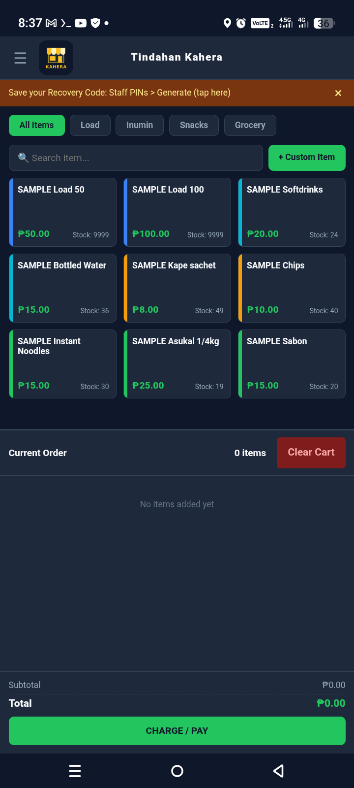
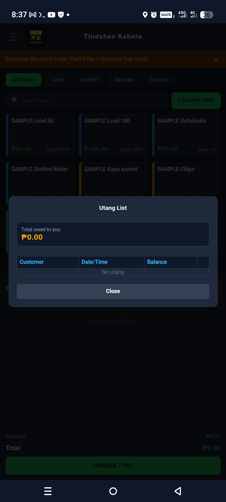
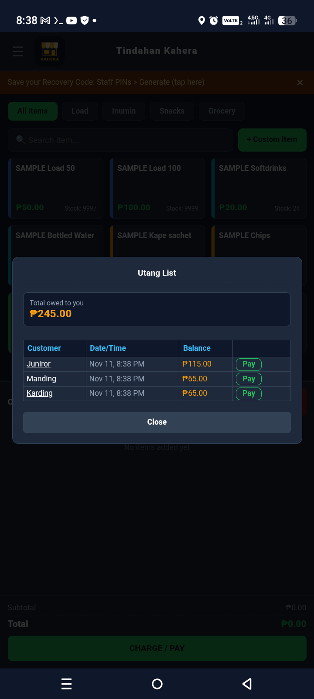
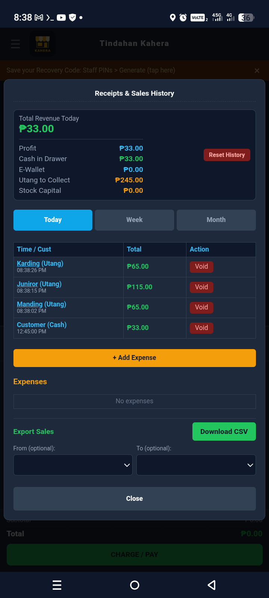

# Tindahan Kahera

Simple POS for sari-sari stores. Flask + SQLite, works offline (PWA).

Features: sales, inventory, utang list, reports, PIN login, offline mode with sync.

Run: pip install flask, then python app.py

Telegram alerts are optional: copy telegram.example.json to telegram.json.

## Screenshots

